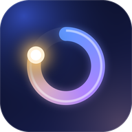

<p align="center"></p>

# 时序 Chrono

> 把「接下来该做什么」交给系统去算的个人时间调度。你只说要做什么,它排出几点几分做。

**时序**是一个本地优先、可离线、可多端同步的个人时间调度应用:电脑、安卓、iPhone 用同一套代码(PWA),另有 Windows 桌面版。

- **一句话录入**:「周三下午三点开会,一个小时,提前半小时准备」→ 自动解析、排程、提醒。
- **截图 / 拍照识别**:接入你自己的大模型(Claude、OpenAI、通义、智谱、Ollama…),图片和文字可以一起发送。
- **会理解需求的助手**:「把周三的高数调到周四下午」「这周五实验课停课」→ 先预览、你确认、可撤销。
- **课表 / 固定周程**:单双周、周次、调课、停课;法定节假日自动停课(内置 2026、2027 官方安排,联网更新)。
- **长期事项**:一直要做、不适合排进日程的事,常驻「今天」页顶部,温和提醒,不累计、不变红。
- **排程引擎**:硬约束先行、截止倒排、精力匹配、缓冲带、默认留白 25%、领域时间预算、每块都能解释「为什么排在这」。
- **隐私**:数据只在你的设备上;多设备同步端到端加密,服务器只看到密文;AI 可以完全关闭。
- **界面**:参考 iOS 27 精修版 Liquid Glass,可调透明度,深色模式。

## 快速开始

| 你想… | 怎么做 |
|---|---|
| 马上试用 | 双击 `Chrono-单文件版.html`(需自行用 `npm run single` 生成) |
| 本地运行 | 安装 Node.js,运行 `node tools/server.js`,打开 http://localhost:8765 (Windows 可双击 `启动.bat`) |
| Windows 安装包 | 见 [`desktop/README.md`](desktop/README.md),或到 Releases 下载 |
| 部署到网上 | 见 [`部署到Cloudflare.md`](部署到Cloudflare.md) |
| 手机使用 | 部署到 https 网址后:安卓 Chrome「安装应用」,iPhone Safari「添加到主屏幕」 |

详细用法见 [`docs/USER-GUIDE.md`](docs/USER-GUIDE.md);更新记录与更多细节见 [`使用说明.md`](使用说明.md)。

## 开发

无构建步骤,纯原生 JavaScript,没有运行时依赖。

```
npm test          # 13 套自动测试(引擎、界面、大模型、同步、节假日、课表、助手…)
npm run single    # 打包成单文件版
node tools/make_icons.py   # 重新生成图标(需要 Python + Pillow)
```

目录结构:

| 文件 | 作用 |
|---|---|
| `core.js` | 数据模型、本地存储、时间工具 |
| `parse.js` | 中文口语解析、课表文字解析、估时学习 |
| `sched.js` | 调度引擎、冲突消解、固定周程、洞察、导出 |
| `holiday.js` | 法定节假日数据与调休 |
| `longterm.js` | 长期事项 |
| `llm.js` / `agent.js` | 大模型接入、截图识别、助手(理解需求 → 结构化操作 → 确认 → 执行) |
| `sync.js` | 端到端加密的多设备同步 |
| `app.js` / `views.js` / `today.js` / `boot.js` | 界面与事件 |
| `cloud/` | Cloudflare 云函数(同步、AI 代理、授权码)与管理后台 |
| `tools/` | 本地服务(Node/Python)、同步 Worker、打包脚本 |
| `desktop/` | Windows 桌面版(Electron) |

欢迎贡献,见 [CONTRIBUTING.md](CONTRIBUTING.md)。

## 隐私与安全

- 所有事项、设置只保存在浏览器本地存储里。
- 大模型的 API Key 只保存在你自己的设备上,请求直接发往你选择的服务商(或你自己的代理)。
- 同步内容在设备上用 AES-GCM 加密后才上传,密钥由「同步码」派生;**同步码丢失无法找回云端数据**。
- 发现安全问题请通过 Issue 私下联系维护者,不要公开贴出 Key 或同步码。

## 路线图

- [ ] 原生 iOS / 安卓壳(Capacitor,系统日历双向同步、锁屏小组件)
- [ ] 邮件、网页链接的事项抽取
- [ ] 更多语言(目前界面与解析为简体中文)
- [ ] macOS / Linux 桌面版

## 许可证与商业授权

本项目采用 **[AGPL-3.0-or-later](LICENSE)**:任何人都可以自由使用、修改、再发布;但如果你修改后做成网站或服务对外提供,必须同样公开你的修改。

- 个人使用、学习、自建部署:免费,遵守 AGPL 即可。
- 想在闭源产品中使用,或不愿公开修改:可向版权持有人申请**商业授权**(见 [`docs/BACKEND-PLAN.md`](docs/BACKEND-PLAN.md) 第 1 节)。
- 贡献代码前请阅读 [CLA.md](CLA.md)。
- 官方托管服务(同步、AI 额度等)是独立运营的商业服务,与源码授权无关。

法定节假日数据整理自国务院办公厅公开通知。

---

## English summary

**Chrono (时序)** is a local-first personal time scheduler: natural-language capture (Chinese), a constraint-based scheduler that explains every placement, timetable/recurring schedules with Chinese statutory-holiday awareness, long-term "always-on" reminders that never pile up as overdue, optional LLM features (screenshot recognition, an assistant that edits your schedule after you confirm), and end-to-end-encrypted multi-device sync. It runs as a PWA on desktop/Android/iOS and ships a Windows desktop build (Electron). No build step, no runtime dependencies. AGPL-3.0-or-later licensed (commercial licenses available from the copyright holder). The UI is currently Simplified Chinese only; i18n contributions are welcome.
